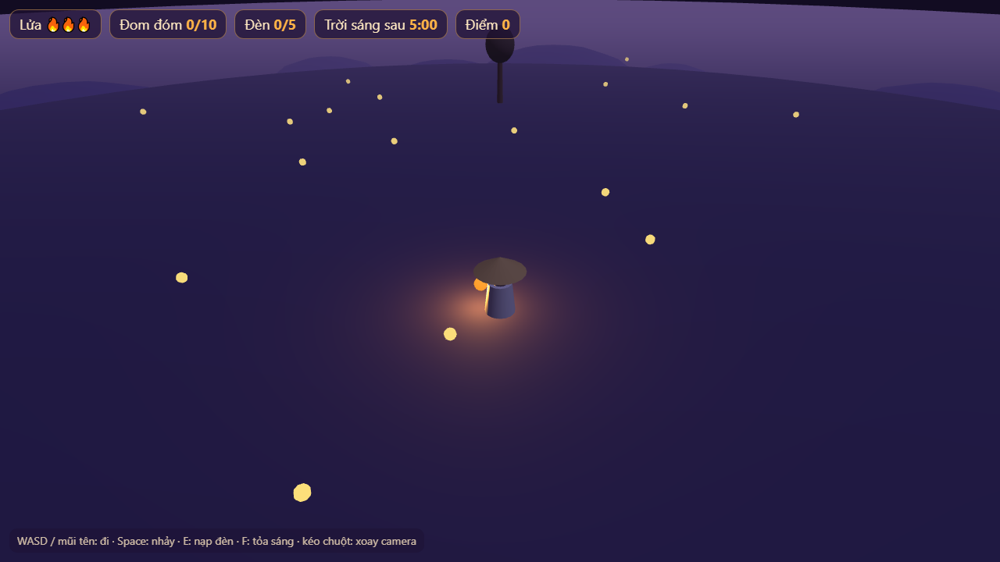

**Video demo:** https://github.com/ecaep7/K5-L3A-DAY12-DoThiThanhBinh-2A202603709-AI-SDLC-Dao-Den-Long/releases/download/v1.0.0/demo.mp4
# Đảo Đèn Lồng

Game 3D trên trình duyệt: bạn là Mây, người giữ đèn nhỏ tuổi. Nhặt đom đóm, thắp và châm dầu cho các Đèn Lồng Lớn, xua Bóng Mực và giữ đủ đèn sáng đến khi trời sáng (Đêm 1: 240 s).



## Yêu cầu hệ thống
- Node.js ≥ 20, npm. Chạy trên macOS, Linux, Windows.
- Trình duyệt có WebGL (Chrome, Edge, Firefox, Safari mới).
- Chỉ để chạy bench: cần tải Chromium của Playwright (khoảng 150 MB, lệnh cài đã gồm).

## Cài đặt và chạy (3 lệnh, macOS/Linux)
```
git clone https://github.com/ecaep7/K5-L3A-DAY12-DoThiThanhBinh-2A202603709-AI-SDLC-Dao-Den-Long.git && cd K5-L3A-DAY12-DoThiThanhBinh-2A202603709-AI-SDLC-Dao-Den-Long
npm install && npx playwright install chromium
npm run dev          # mở http://localhost:5173
```
(Đây cũng là `build_cmd` / `run_cmd` trong `game.contract.json`. Nếu chỉ muốn chơi, bỏ phần `npx playwright install chromium`.)

Chơi từ bản đóng gói: tải `dao-den-long-web-v1.0.0.zip` ở trang Release, giải nén, rồi chạy `python3 -m http.server 8080` trong thư mục đó và mở http://localhost:8080 (mở thẳng file `index.html` bằng `file://` không chạy vì trình duyệt chặn module).

Tạo lại bản web tĩnh: `npm run build:web` (ra thư mục `dist/`).

## Điều khiển
| Phím | Việc |
|---|---|
| WASD / mũi tên | đi (theo hướng camera) |
| Space | nhảy |
| E | tương tác: nạp đom đóm vào đèn gần (trong 2 m) để thắp hoặc châm dầu |
| F hoặc Shift trái | tỏa sáng (tốn 3 đom đóm) |
| Q | lướt (thêm để HUD có biểu tượng hồi chiêu Lướt dùng được) |
| kéo chuột trái | xoay camera |
| Enter | chơi lại khi ván kết thúc |
| Esc hoặc P | tạm dừng (Tiếp tục / Chơi lại Đêm / Cài đặt / Về menu) |

Menu chính: chơi chuỗi 3 Đêm (1→2→3, hiện tổng điểm và màn Bình Minh khi thắng Đêm 3) hoặc chọn riêng từng Đêm. Cuối Đêm có màn kết quả: Đêm kế tiếp (trong chuỗi) / Chơi lại Đêm / Về menu. Lướt và tạm dừng có trong luật (headless) nhưng chưa có phím trong giao diện, xem "Chưa đạt".

Tạm dừng dừng hẳn logic (không bước sim). Cài đặt (âm lượng, độ nhạy chuột) lưu bằng localStorage. Âm thanh tự sinh bằng WebAudio (nhạc nền nhẹ; hiệu ứng nhặt, thắp đèn, tỏa sáng, bị đánh, nhảy, lướt, thắng, thua, Bóng Mực xuất hiện, tích tắc 10 s cuối), bật sau cú nhấp đầu tiên.

Giao diện theo Ticket-02: bảng màu chuẩn (trời #0E1430, sương #1B2350, cỏ #2F5D50, cát #C9B48A, gỗ #6B4A2F, biển mây #12384A, đèn #FFB347/#FFE9B0/#5B5F6E, đom đóm #FFF6C2/#FFE58A, Bóng Mực #120A1A/#7A3CFF/#3A3450, áo #E8E2D0, khăn #C8102E, Gió Lạc #8FA3B8, chữ UI #F5F1E6), ánh sáng môi trường = 0.15 + 0.55 × (đèn sáng/tổng đèn). HUD: Ngọn Lửa trên trái; đồng hồ mm:ss trên giữa; đèn k/n và điểm trên phải; thanh đom đóm 10 ô dưới giữa; hồi chiêu Lướt/Tỏa Sáng dưới phải; nhắc "E — Nạp ánh sáng (x/10)" khi đứng gần đèn; mũi tên tới đèn chưa sáng gần nhất khi nó ngoài màn hình. Chữ UI ≥ 18 px ở 1280×720 (kiểm bằng script: không còn phần tử HUD nào dưới 18 px). Thêm: thanh dầu trên đèn đang sáng (đỏ và nhấp nháy 1 Hz khi fuel < 30), đồng hồ đổi đỏ khi còn ≤ 30 s, vẽ Gió Lạc (dải xám xanh) và Bùa Gió (lá bùa đỏ viền vàng). Ảnh: `docs/proof/ui-night2.png`, `ui-night3.png`, `ui2-prompt.png`, `ui2-arrow.png`. Màu lệch nhẹ so với mã hex vì chịu ánh sáng 3D (vật liệu dùng đúng mã hex gốc). Chưa làm: tùy chọn chữ lớn ×1.25, ô "Đom đóm" xếp theo tỉ lệ sức chứa khi sức chứa > 10 (mỗi ô = sức chứa/10).

## Luật tóm tắt (Contract v1.2)
Đèn thắp cần 10 đom đóm (thắp lại sau khi cạn: 5). Đèn sáng có dầu 0–100, hao 1/s; hết dầu thì tắt. Chỉ đèn có dầu ≥ 30 mới tạo vùng an toàn 6 m. Bóng Mực đi tới đèn yếu để hút dầu 5/s. Hết giờ mà Mây còn sống và có ≥ 60% đèn sáng thì thắng (`dawn_survived`). Bị chạm: mất 1 lửa (có 3). Chi tiết: `docs/notes/assumptions.md`, lý do đổi luật: `docs/adr/0001-lantern-fuel-and-win-rule.md`.

## Chạy test
```
npm test             # node:test, không thêm thư viện test
```

## Headless
```
node src/headless.js --seed 1 --night 1 --ticks 600 --out out/run.jsonl [--scenario f.json] [--inputs f.json] [--snapshot-every 10]
```
Mã thoát: 0 ok · 2 inputs/scenario sai định dạng · 1 lỗi khác. Cùng seed + scenario + inputs cho output giống hệt từng byte. `--night` nhận 1, 2, 3.

## Bench (Contract v1.3)
```
node bench/bench.mjs --seed 42 --duration 30 --out bench.json
```
Mở cửa sổ Chrome (hoặc Chromium của Playwright) 1280×720 qua Playwright, dựng cảnh chuẩn (Đêm 1, 200 Bóng Mực wander, 100 đom đóm, 3 đèn L1–L3 fuel 100, camera bay vòng 30 m, cao 15 m, 15 s/vòng), khởi động 3 s rồi đo `--duration` giây. Tắt vsync bằng cờ Chromium `--disable-frame-rate-limit --disable-gpu-vsync`; một số GPU/trình điều khiển vẫn có thể ép vsync (trường `vsync_off` chỉ cho biết cờ đã được đặt). `peak_mem_mb = null`: bản web không đọc được RSS của tiến trình trình duyệt từ trang. Kết quả đã chạy thật trên máy tác giả: `bench.json`. Tự build `dist/` lần đầu nếu chưa có.

## Soak
```
node src/soak.js --seed 7 --nights 10 --out soak.json
```
Chạy 10 Đêm liên tiếp trong một tiến trình, xoay vòng Đêm 1 → 2 → 3 (Đêm i dùng seed 7+i, input ngẫu nhiên theo seed). Ép GC trước khi đo RSS. Kết quả đã chạy thật: `soak.json` (0 crash; xem "Chưa đạt" về ngưỡng bộ nhớ).

## Cấu trúc
- `src/sim/`: logic thuần, tất định (PRNG có seed, không Three.js, không `Math.random`/`Date`).
- `src/headless.js`, `src/soak.js`: CLI. `bench/`: benchmark. `web/`: giao diện Three.js + Vite, dùng lại `src/sim`.
- `tests/`: node:test. `game.contract.json`: tuning và lệnh khai báo cho giảng viên.
- `docs/`: giả định, nhật ký AI, truy vết luật → test (`docs/proof/traceability.md`).

## Chưa đạt
Phần chưa làm, nói thẳng:
- **Đêm 2 và Đêm 3**: đã có trong sim và headless (bản đồ, cầu, tầng, dốc, bục nhảy, tháp chuông, gió mạnh, Bóng Mực 4.5 m/s Đêm 3), và chơi được trong giao diện web. Phần giao diện này chưa có test tự động (chỉ kiểm bằng trình duyệt thật: menu, chuyển Đêm, kết quả; xem ảnh). Test tự động chỉ là scenario (`tests/nights.test.js`); tầng/vách của Bóng Mực được đơn giản hóa (Bóng Mực không bị vách chặn, chỉ bám độ cao mặt đất); điểm xuất phát Đêm 2/3 không có trong ticket (tự chọn: (0,0,0) và (0,0,-20)); sự kiện `jump_pad`, `wind_warning/start/end` do tôi đặt tên.
- **Soak không đạt ngưỡng bộ nhớ**: `soak.json` hiện có `mem_end_mb` 44.9 > 1.2 × `mem_start_mb` 36.1 (tỉ lệ 1.24, chạy lại 5 lần đều 1.23–1.25). Đã tìm nguyên nhân: đây không phải dữ liệu Đêm trước còn bị giữ. Heap JS sau GC chỉ tăng ~0.4 MB qua 10 Đêm (và phẳng qua 200 Đêm); RSS nhảy ~10 MB ngay trong Đêm đầu tiên rồi dao động quanh mức đó. Với `node --jitless`, RSS 30.9 → 32.3 MB (+4%), nên phần tăng là bộ nhớ mã JIT/bộ cấp phát khi nóng máy. Giữ nguyên cách đo (`mem_start_mb` sau khi dựng Đêm đầu), nên ghi là chưa đạt.
- **Gió Lạc và Bùa Gió**: có trong sim + headless (Đêm 2, 3; `tests/drifters.test.js`) và đã vẽ trong web (hình khối đơn giản, thông báo chữ). Chưa có lá bay báo gió (chỉ có thông báo chữ), màn giới thiệu Đêm có lời Ông Đăng. Âm thanh chưa được nghe thử bằng tai: tôi chỉ kiểm bằng trình duyệt rằng AudioContext tạo được và không có lỗi; chất lượng âm chưa đánh giá. Gió Lạc idle lượn đến điểm ngẫu nhiên (tự chọn); sự kiện `drifter_spawned` do tôi đặt; Tỏa Sáng không cho điểm khi trúng Gió Lạc.
- **Bảng xếp hạng cục bộ** (mục 3), lệnh `--export-leaderboard`: chưa làm.
- **Dễ tiếp cận** (mục 4): đổi phím, phụ đề/mũi tên chỉ báo, giảm chuyển động, chữ lớn ×1.25: chưa làm. Cũng chưa có phím lướt/tạm dừng và chế độ mù màu.
- **Hiệu năng**: trên máy tác giả `p1_low_fps` = 30, chỉ vừa chạm ngưỡng 30; chưa tối ưu. Số chấm chính thức là của máy giảng viên.
- **Bench**: `peak_mem_mb` = null (xem trên). Hai lần chạy đầu tiên bị đóng trình duyệt giữa chừng (chưa rõ nguyên nhân), lần thứ ba xong; chưa xử lý tự thử lại.
- **Soak**: `results` toàn `lost` vì input ngẫu nhiên không thắp đèn có chủ đích; chạy 200 Đêm cho thấy heap phẳng (không rò) nhưng RSS tăng nhẹ theo bộ cấp phát.
- **Âm thanh**: không có nhạc nền/hiệu ứng thật (không có file), chỉ âm tổng hợp đơn giản; không có hiệu ứng riêng cho Gió Lạc rơi/gió thổi; không có test tự động cho âm thanh, tạm dừng và cài đặt.
- **Retro, video demo .mp4, GitHub Release v1.0.0**: chưa làm (tác giả tự làm; tag `phase-4` cũng do tác giả).
- Bản chạy được cho Release: có file zip web tĩnh ở `release/` (không commit), kèm hướng dẫn ở trên.
- Chưa kiểm tra trên macOS/Linux sạch; các lệnh cài chỉ đã chạy trên Windows.
